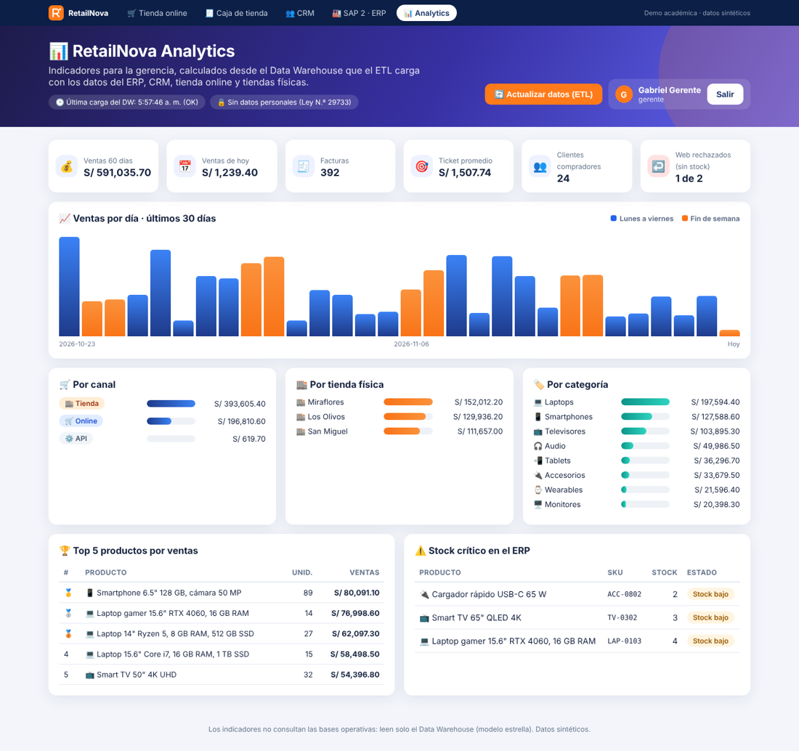
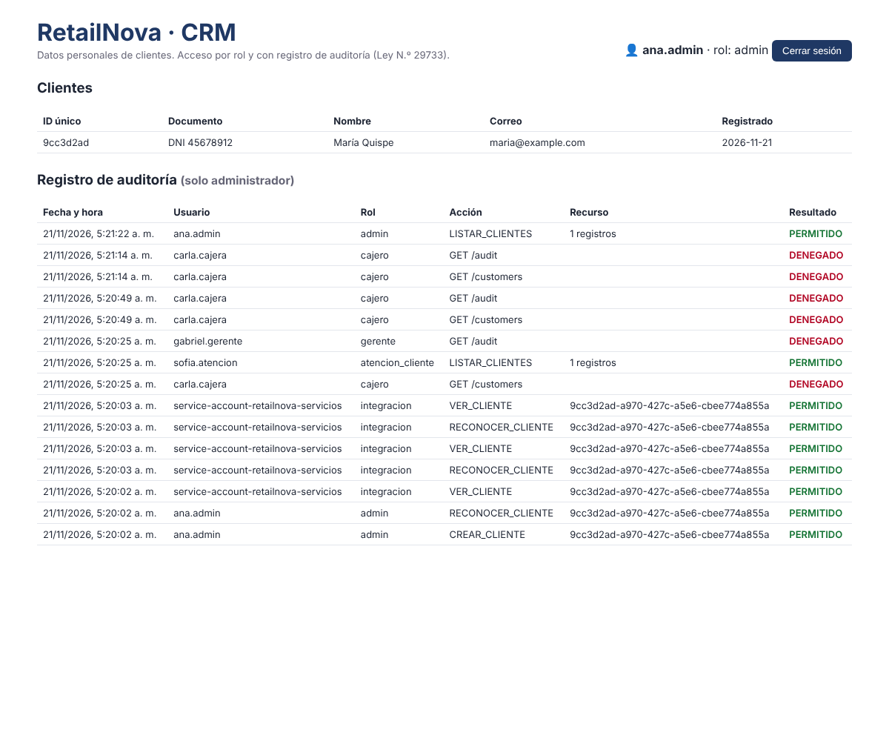

# RetailNova Enterprise Architecture

Trabajo integrador de Arquitectura Empresarial (TOGAF, ciclo 2026-2) y demo local.

## Estructura
- `docs/` – documentos de arquitectura (Fases A–H).
- `demo/` – demo local: ERP, CRM, e-commerce, POS, ETL/DW, dashboard.
- `demo/agent-gateway/` – reservado para el MVP (agentes de IA). Vacío por ahora.

## Principio de diseño
Cada sistema tiene su **propia base de datos**. "Una sola fuente de verdad" significa
un sistema oficial por dato (p. ej., el CRM genera el ID único de cliente), no una base compartida.

## Requisitos
- Docker Desktop (WSL2 en Windows). Todo es gratuito; no se usan APIs de pago.

## Levantar (Sprint 0)
```bash
cd demo
cp .env.example .env      # cambia las contraseñas
docker compose up -d
docker compose ps         # las bases deben quedar "healthy"
```
- RabbitMQ: http://localhost:15672
- Keycloak: http://localhost:8080

Detener: `docker compose down` (conserva datos) · `docker compose down -v` (borra datos).

## Seguridad
`.env` nunca se sube a Git. Solo datos sintéticos. Ver `docs/` para Ley N.º 29733.

## Plan
Sprint 0 base · 1 ERP+CRM+ID único · 2 e-commerce+POS+eventos · 3 DW+dashboard · 4 seguridad+pruebas+guion.

## Sprint 1: CRM y ERP
- CRM (http://localhost:8001/docs): clientes con **ID único**; un documento o correo repetido devuelve el mismo cliente (no duplica).
- ERP (http://localhost:8002/docs): productos, stock y facturas con IGV 18 %. Valida el `customer_id` llamando a la API del CRM; guarda solo la referencia (sin compartir base de datos).
- Demo rápida (con los contenedores arriba): `pip install httpx && python demo/scripts/seed_and_demo.py`
- Pruebas: `cd demo/crm && pip install -r requirements-dev.txt && pytest` (igual en `demo/erp`).
- Pendiente de sprints siguientes: autenticación Keycloak (Sprint 4), eventos RabbitMQ (Sprint 2).

## Sprint 2: e-commerce, POS de tienda y eventos (RabbitMQ)
| Sistema | Dirección | Base propia |
|---|---|---|
| Tienda online (e-commerce) | http://localhost:8003 | `ecommerce-db` |
| Caja de tienda (POS) | http://localhost:8004 | `pos-db` |

Flujo:
1. **Pedido web:** el e-commerce registra al cliente en el CRM (ID único, llamada síncrona), guarda el pedido en su base y publica `order.created`. El ERP factura, descuenta stock y responde `invoice.created.ecommerce` (o `order.rejected.ecommerce` si no hay stock).
2. **Venta en tienda:** el POS guarda la venta en su base **aunque no haya red** (estado `EN_COLA`). Cuando vuelve la red, la envía como `sale.created` y el ERP responde `invoice.created.pos`.

Buenas prácticas incluidas: bandeja de salida (outbox) con reintento automático, idempotencia en el ERP (un mismo evento nunca factura dos veces), reintento si el CRM está caído y cola `retailnova.dead-letters` para mensajes inválidos.

Probar (con los contenedores arriba): `python scripts/demo_eventos.py` → debe terminar en `RESULTADO: OK`.

> Al actualizar desde el Sprint 1: `docker compose down -v` y luego `docker compose up -d --build` (cambió el esquema del ERP).

## Sprint 3: Data Warehouse y panel gerencial
- **ETL** (servicio `etl`): cada 30 s lee las bases del ERP, CRM, e-commerce y POS y carga el **Data Warehouse** (`dw-db`) en un modelo estrella: `fact_sales`, `fact_orders`, `dim_product`, `dim_customer`, `dim_channel`, `dim_date`. Carga completa en una sola transacción (todo o nada) y registro de cada corrida en `etl_runs`.
- **Panel gerencial:** http://localhost:8005. Muestra ventas totales, facturas, ticket promedio, ventas por canal y por día, top productos, stock con alerta, tasa de rechazo web y ventas de tienda en cola. Calcula todo **solo desde el DW**, nunca desde las bases operativas.
- **Ley N.º 29733 (minimización):** el DW no guarda nombres, correos ni documentos; solo el ID seudónimo del CRM.
- El botón "Actualizar datos (ETL)" fuerza una carga inmediata.



## Sprint 4: seguridad (Keycloak, roles, auditoría, Ley N.º 29733)
**Usuarios de prueba** (contraseña = `DEMO_USERS_PASSWORD` de tu `.env`):

| Usuario | Rol | Puede |
|---|---|---|
| `ana.admin` | admin | Todo, incluido el registro de auditoría |
| `gabriel.gerente` | gerente | Panel gerencial (:8005) y facturas del ERP |
| `carla.cajera` | cajero | Caja de tienda (:8004) |
| `sofia.atencion` | atencion_cliente | Datos personales de clientes en el CRM (:8001) |

La tienda online (:8003) sigue siendo pública, como para cualquier cliente.

Qué se implementó:
- **Aplicación:** inicio de sesión en la pantalla oficial de Keycloak (OpenID Connect con PKCE; la página nunca ve la contraseña), tokens firmados que cada sistema valida, roles por endpoint, sesión única (SSO) entre páginas y bloqueo tras 5 intentos fallidos.
- **Entre sistemas:** cada llamada usa una cuenta de servicio (`retailnova-servicios`, rol `integracion`), no un acceso abierto.
- **Datos:** el CRM registra cada acceso a datos personales, permitido o denegado (quién, cuándo, qué, desde qué IP); solo el admin lo ve. El ETL lee las bases con un usuario de **solo lectura** (`etl_reader`). El DW no guarda datos personales.
- **Infraestructura:** secretos solo en `.env` (fuera de Git); cada base en su propio contenedor; Keycloak con verificación de salud.

Probar: `python scripts/demo_seguridad.py` → `RESULTADO: OK`. Si tienes dudas con tu `.env`: `python scripts/verificar_env.py`.

> Al actualizar desde el Sprint 3: agrega a tu `.env` las 3 variables nuevas de `.env.example` (`SERVICE_CLIENT_SECRET`, `DEMO_USERS_PASSWORD`, `ETL_READER_PASSWORD`) y ejecuta `docker compose down -v` y `docker compose up -d --build`.


